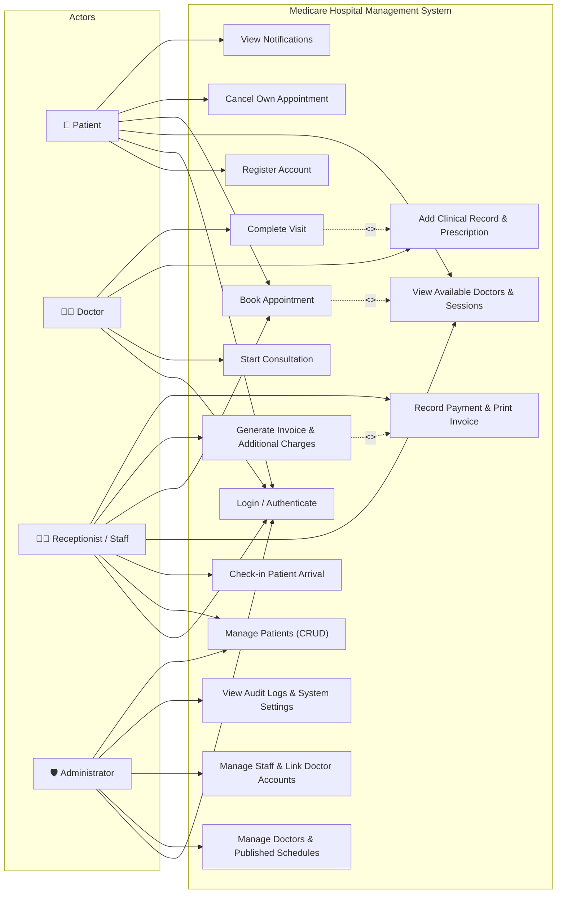
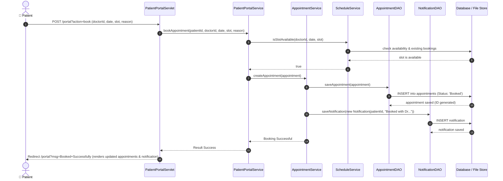
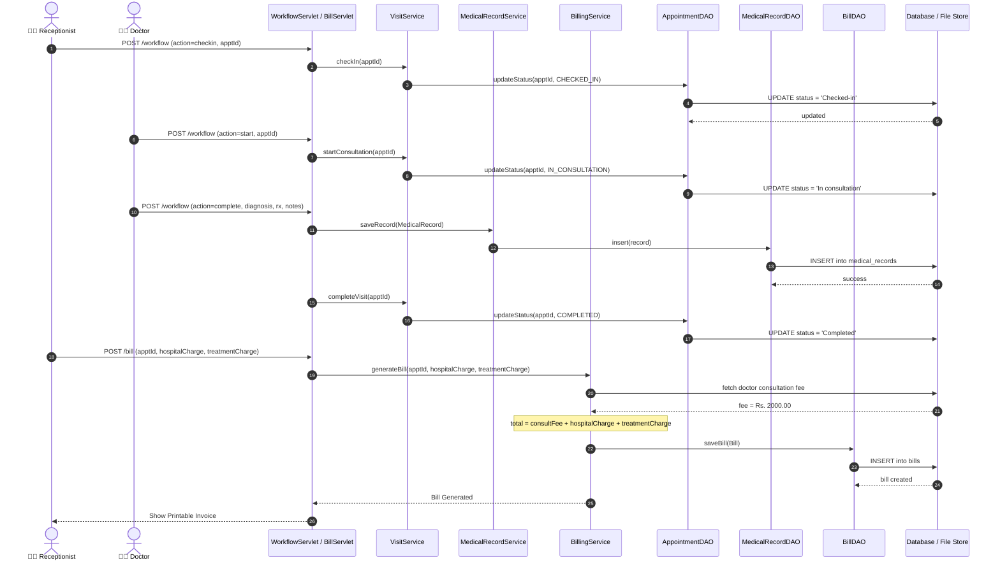
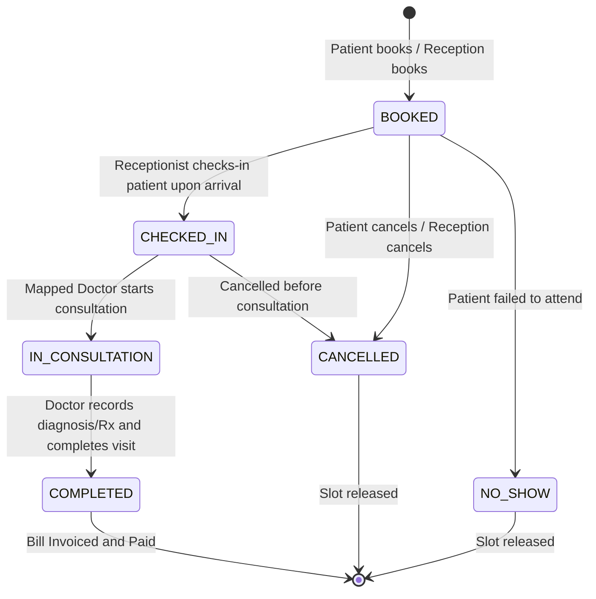

```mermaid
classDiagram
    %% Inheritance hierarchy
    Person <|-- Patient
    Person <|-- Doctor
    Person <|-- User

    %% DAO Inheritance and Realization
    AbstractFileDAO <|-- PatientDAOFileImpl
    AbstractFileDAO <|-- DoctorDAOFileImpl
    AbstractFileDAO <|-- AppointmentDAOFileImpl
    AbstractFileDAO <|-- MedicalRecordDAOFileImpl
    AbstractFileDAO <|-- BillDAOFileImpl
    AbstractFileDAO <|-- NotificationDAOFileImpl
    AbstractFileDAO <|-- UserDAOFileImpl

    PatientDAO <|.. PatientDAOFileImpl
    PatientDAO <|.. PatientDAODBImpl
    DoctorDAO <|.. DoctorDAOFileImpl
    DoctorDAO <|.. DoctorDAODBImpl
    AppointmentDAO <|.. AppointmentDAOFileImpl
    AppointmentDAO <|.. AppointmentDAODBImpl
    MedicalRecordDAO <|.. MedicalRecordDAOFileImpl
    MedicalRecordDAO <|.. MedicalRecordDAODBImpl
    BillDAO <|.. BillDAOFileImpl
    BillDAO <|.. BillDAODBImpl
    NotificationDAO <|.. NotificationDAOFileImpl
    NotificationDAO <|.. NotificationDAODBImpl
    UserDAO <|.. UserDAOFileImpl
    UserDAO <|.. UserDAODBImpl

    %% Factory and Services
    DAOFactory ..> PatientDAO : creates
    DAOFactory ..> DoctorDAO : creates
    DAOFactory ..> AppointmentDAO : creates
    DAOFactory ..> MedicalRecordDAO : creates
    DAOFactory ..> BillDAO : creates
    DAOFactory ..> NotificationDAO : creates
    DAOFactory ..> UserDAO : creates

    PatientService --> PatientDAO
    DoctorService --> DoctorDAO
    AppointmentService --> AppointmentDAO
    AppointmentService --> ScheduleService
    ScheduleService --> ClinicStore
    MedicalRecordService --> MedicalRecordDAO
    BillingService --> BillDAO
    VisitService --> AppointmentService
    VisitService --> MedicalRecordService
    PatientPortalService --> AppointmentService
    PatientPortalService --> PatientService
    AccountService --> UserDAO
    AccountService --> DoctorDAO

    %% Model relationships
    Appointment --> AppointmentStatus : has status
    Appointment --> Patient : patientId
    Appointment --> Doctor : doctorId
    MedicalRecord --> Appointment : appointmentId
    Bill --> Appointment : appointmentId

    class Person {
        <<abstract>>
        +getName()* String
        +getEmail()* String
        +getRoleLabel()* String
        +getDisplayName() String
    }

    class Patient {
        -String id
        -String name
        -String email
        -int age
        -String gender
        -String contact
        -String address
        -String medicalHistory
        +getRoleLabel() String
        +getId() String
        +getMedicalHistory() String
    }

    class Doctor {
        -String id
        -String name
        -String specialization
        -String qualification
        -String phone
        -String email
        -double consultationFee
        +getRoleLabel() String
        +getId() String
        +getSpecialization() String
        +getConsultationFee() double
    }

    class User {
        -int id
        -String username
        -String password
        -String role
        -String name
        -String email
        +getRoleLabel() String
        +getId() int
        +getUsername() String
        +getRole() String
    }

    class Appointment {
        -int appointmentId
        -String patientId
        -String doctorId
        -String appointmentDate
        -String appointmentTime
        -String reason
        -String status
        +getAppointmentId() int
        +getStatus() String
        +setStatus(String) void
    }

    class AppointmentStatus {
        <<enumeration>>
        BOOKED
        CHECKED_IN
        IN_CONSULTATION
        COMPLETED
        CANCELLED
        NO_SHOW
        +canMoveTo(AppointmentStatus) boolean
        +reservesSlot() boolean
        +label() String
    }

    class MedicalRecord {
        -int recordId
        -String patientId
        -String doctorId
        -int appointmentId
        -String diagnosis
        -String prescription
        -String notes
        -String recordDate
        +getRecordId() int
        +getPrescription() String
        +getDiagnosis() String
    }

    class Bill {
        -int billId
        -int appointmentId
        -String patientId
        -double amount
        -double consultationCharge
        -double hospitalCharge
        -double treatmentCharge
        -String paymentMethod
        -String paymentStatus
        +getAmount() double
        +getHospitalCharge() double
        +getTreatmentCharge() double
        +getPaymentStatus() String
    }

    class Notification {
        -int notificationId
        -String patientId
        -String message
        -String date
        +getMessage() String
    }

    class AbstractFileDAO {
        <<abstract>>
        #readAll() List
        #writeAll(List) boolean
        #insert(Object) boolean
        #replace(Object, Predicate) boolean
        #remove(Predicate) boolean
    }

    class DAOFactory {
        +getPatientDAO() PatientDAO$
        +getDoctorDAO() DoctorDAO$
        +getAppointmentDAO() AppointmentDAO$
        +getMedicalRecordDAO() MedicalRecordDAO$
        +getBillDAO() BillDAO$
        +getUserDAO() UserDAO$
        +getNotificationDAO() NotificationDAO$
    }
```

# Medicare - Medical Appointment System

SE1020 Object Oriented Programming coursework: a Java web application for medical appointments and clinic management.

## Features

- Patient portal and appointment booking
- Doctor availability and scheduling
- Patient and medical record management
- Billing, insurance claims, and notifications
- Staff accounts and audit logs
- File storage and MySQL storage implementations

## Technology

Java 11, Maven, JSP, Java Servlet 4, JDBC, MySQL, HTML, CSS, and JavaScript. Deploy to Apache Tomcat 9.

## Documentation hub

Browse [all project documents](docs/) or open a guide below.

| Document | What you will find |
| --- | --- |
| [Project manual](docs/PROJECT_MANUAL.md) | Installation, configuration, and user guide |
| [Complete UML diagrams](docs/UML_DIAGRAMS.md) | Use cases, class design, sequence diagrams, and appointment states |
| [Class diagram and OOP design](docs/CLASS_DIAGRAM.md) | Classes, relationships, and OOP architecture |
| [Technical report](docs/TECHNICAL_REPORT.md) | Implementation and technical details |
| [Database migration](docs/DB_MIGRATION.md) | Database setup and migration instructions |
| [Demo walkthrough](docs/DEMO_WALKTHROUGH.md) | Demonstration steps |
| [Guideline mapping](docs/GUIDELINE_MAPPING.md) | Coursework requirement mapping |
| [Team tasks](docs/TEAM-TASKS.md) | Workload and task distribution |
| [Team contributions](docs/TEAM_CONTRIBUTIONS.md) | Team contribution documentation |
| [GitHub contributions](docs/GITHUB_CONTRIBUTIONS.md) | Contribution tracking guidance |
| [Git workflow](docs/GIT-WORKFLOW.md) | Branch and collaboration workflow |
| [Test results](docs/TEST_RESULTS.md) | Supplied test report |
| [Patient portal tests](docs/PATIENT_PORTAL_TESTS.md) | Supplied patient portal test notes |
| [ZIP update notes](docs/ZIP_UPDATE_NOTES.md) | Changes included in the project distribution |

## UML diagrams

The diagrams below are taken from [the complete UML document](docs/UML_DIAGRAMS.md). Expand a diagram to view it here.

<details>
<summary>Use Case Diagram</summary>



</details>

<details>
<summary>Complete System Class Diagram (OOP Design)</summary>



</details>

<details>
<summary>Sequence Diagram 1: Patient Self-Service Appointment Booking</summary>



</details>

<details>
<summary>Sequence Diagram 2: Clinical Consultation & Billing Workflow</summary>



</details>

<details>
<summary>State Machine Diagram: Appointment Lifecycle</summary>



</details>

## Build and test

Install a JDK (11 or later) and run from this directory on Windows:

```powershell
.\mvnw.cmd clean verify
```

The build produces `target/medicare-app.war`. Deploy it to Tomcat 9's `webapps` directory. The supplied `dist/medicare-app.war` is the original prebuilt distribution.

- Patient portal: `http://localhost:8080/medicare-app/portal`
- Staff portal: `http://localhost:8080/medicare-app/login.jsp`

The source defaults to file storage. For configuration, database imports, and deployment details, read [the project manual](docs/PROJECT_MANUAL.md) and [database migration guide](docs/DB_MIGRATION.md).

## Project structure

| Path | Contents |
| --- | --- |
| `src/main/java` | Models, DAO implementations, services, and servlets |
| `src/main/webapp` | JSP pages and static assets |
| `src/test` | Java regression tests and HTTP integration scripts |
| `database` | SQL exports and migration scripts |
| `docs` | Manuals, diagrams, and existing test reports |
| `scripts` | Offline build and smoke-test helpers |
| `dist` | Original prebuilt WAR |
| `tools/test-libs` | Bundled offline test dependencies |

## Data handling

The supplied SQL exports contain demonstration records and demo account credentials, confirmed by the project owner for this coursework upload. Use these accounts only for local demonstrations. Local runtime data and environment files are ignored by Git.

## Documentation

Start with `START_HERE_SINHALA.txt`. Additional documentation is under `docs/`. Existing test reports were included in the supplied project; they do not represent a fresh test run of this upload.
