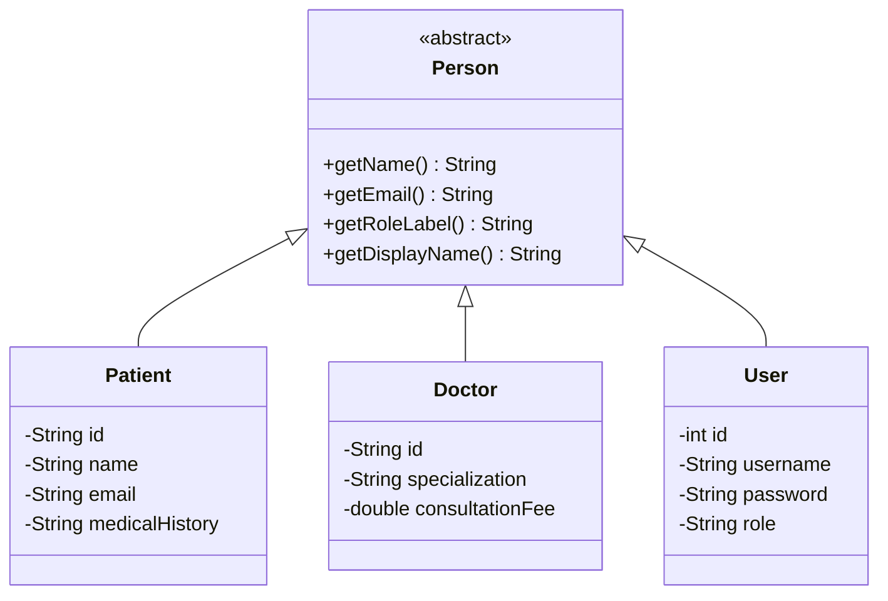
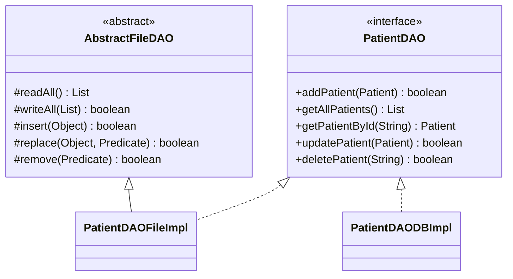
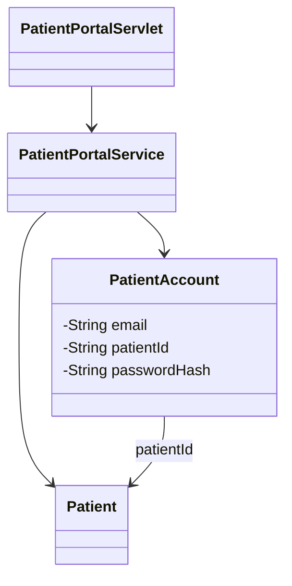
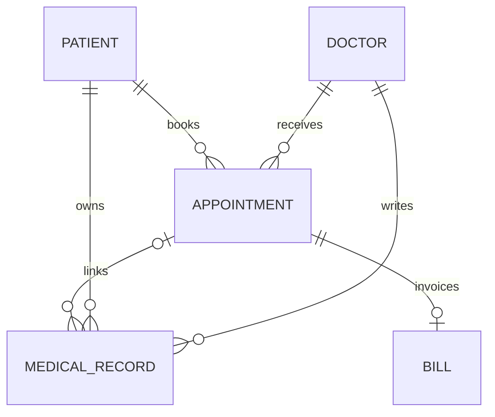
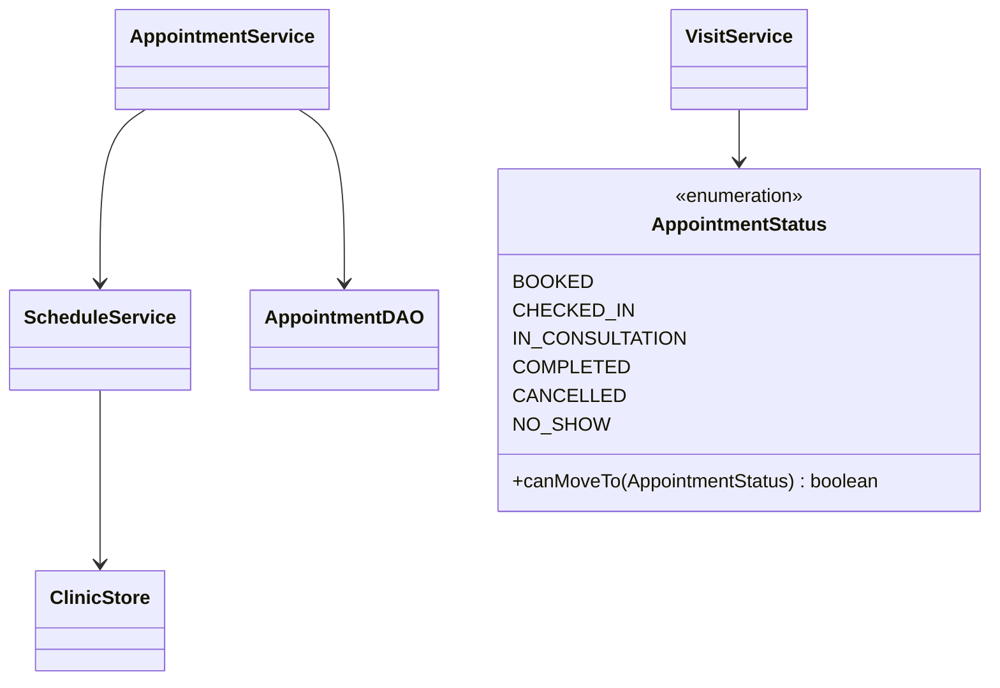
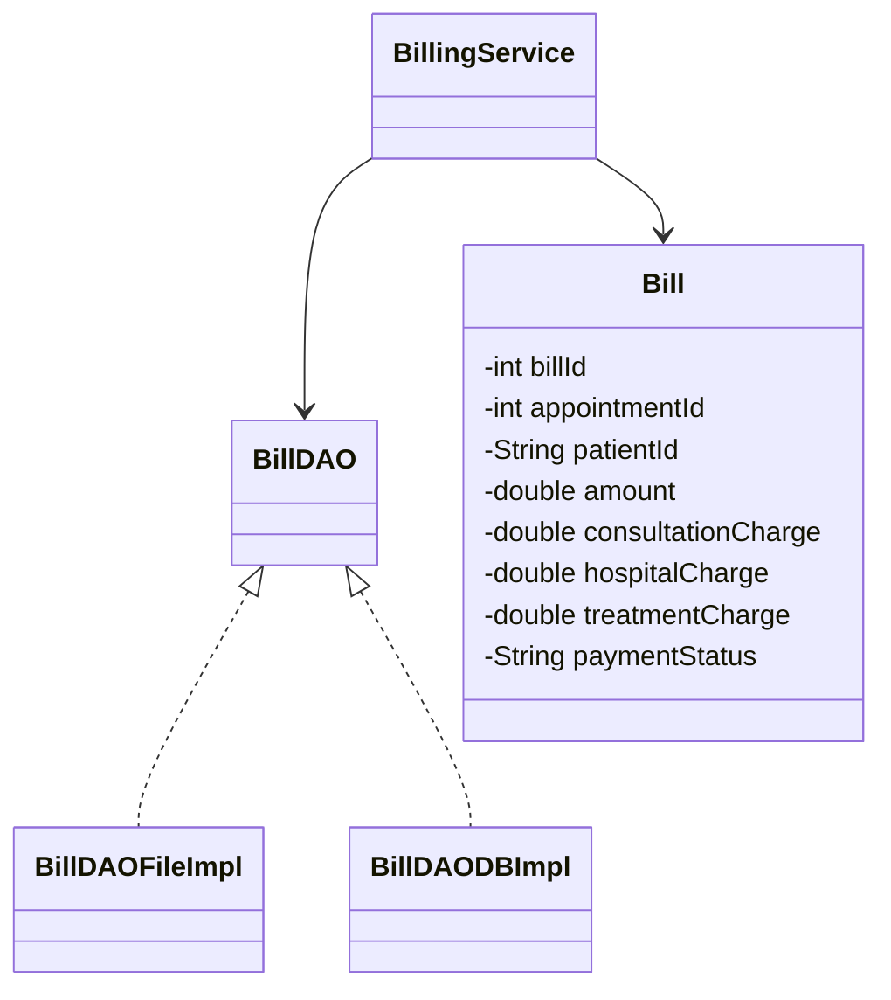

# Current class and relationship diagrams

These are scoped diagrams; ID links below are logical associations, not Java collection fields.

The same DAO interface/implementation pattern covers doctors, appointments, medical records, billing, users and notifications. DAOFactory chooses the concrete implementation. Servlets call services; AccountService additionally owns transactions spanning account and doctor mapping writes. FileTransactions owns runtime rollback of related FILE changes.

PatientAccount is a separate patient login identity; User remains the internal team identity. Public registration creates a new patient profile and login together. PatientPortalService delegates bookings to AppointmentService. Patient-owned notifications are rendered by PatientPortalServlet.

A MedicalRecord has a required patient and doctor and an optional appointment. A visit has zero or more clinical notes, and at most one bill; completion requires a clinical record. Bill also stores its patient ID, checked against the appointment in the application.

Appointment DAOs save notification events in the same DB transaction or related FILE unit. Booking confirms once; cancellation notifies once when the status changes. Availability and DoctorAccount are linked by doctorId; DoctorAccount additionally links a team userId.

BigDecimal performs validation/addition in BillingService; persisted DECIMAL columns and snapshot fields retain the breakdown. Legacy consultation component defaults to the original stored amount. Payment updates status/method only.
