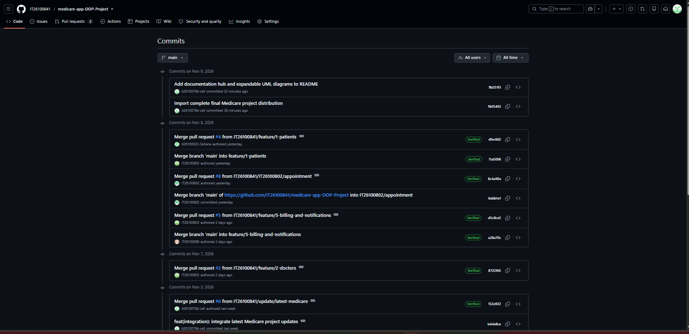
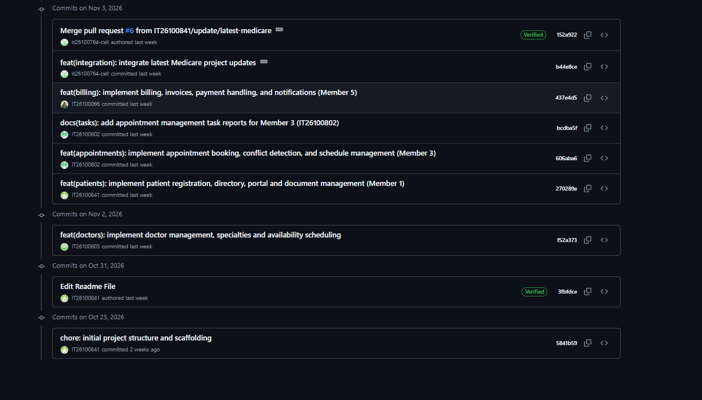

# Version Control and Git Commit History

Medicare Medical Appointment System | SE1020 Object Oriented Programming

GitHub was used to maintain the Medicare project source code and integrate module updates. The main branch history contains 18 commits at verification on 9 November 2026. The records below identify commit messages, account attribution, dates, and links. Module responsibilities are taken from the team contribution document; commit and pull request activity provide supporting evidence.

Repository: [https://github.com/IT26100841/medicare-app-OOP-Project](https://github.com/IT26100841/medicare-app-OOP-Project)

[Live main branch history](https://github.com/IT26100841/medicare-app-OOP-Project/commits/main/)

## Individual contribution evidence

| Member and registration ID | Assigned module | Verified evidence | Links |
| --- | --- | --- | --- |
| Ambegoda S.P / IT26100023 | Patient Management | PR #4 opened by it26100023-Sahana and merged. Patient implementation commit 270289e is attributed to IT26100841. | [PR #4](https://github.com/IT26100841/medicare-app-OOP-Project/pull/4) / [270289e](https://github.com/IT26100841/medicare-app-OOP-Project/commit/270289e9b8812a048a14ccfd47455bbc0abe5f40) |
| Akalanka K.K.G.K / IT26100803 | Doctor and Schedule Management | Implementation commit f52a373 attributed to IT26100803. PR #2 merged. | [PR #2](https://github.com/IT26100841/medicare-app-OOP-Project/pull/2) / [f52a373](https://github.com/IT26100841/medicare-app-OOP-Project/commit/f52a373d1b7b41c8985d4891209f0185d0479766) |
| Wickramasinghe V.I. / IT26100802 | Appointment and Visit Workflow | Implementation commit 606aba6 attributed to IT26100802. PR #8 merged. | [PR #8](https://github.com/IT26100841/medicare-app-OOP-Project/pull/8) / [606aba6](https://github.com/IT26100841/medicare-app-OOP-Project/commit/606aba62d83a1554dc5cac3ec8409dabb55a01b2) |
| Dimath A.M.S / IT26100764 | Medical Records and Platform Integration | Integration commit b44e8ce attributed to it26100764-cell. PR #6 merged. Final upload and README updates are also attributed to this account. | [PR #6](https://github.com/IT26100841/medicare-app-OOP-Project/pull/6) / [b44e8ce](https://github.com/IT26100841/medicare-app-OOP-Project/commit/b44e8cee0a83e8858d7c50e6f811c470185b8439) |
| Sadewma T. M. / IT26100090 | Billing and Notifications | PR #5 opened by IT26100090 and merged. Billing implementation commit 437e4d5 is attributed to IT26100066. | [PR #5](https://github.com/IT26100841/medicare-app-OOP-Project/pull/5) / [437e4d5](https://github.com/IT26100841/medicare-app-OOP-Project/commit/437e4d578ddeab3c5449f16b09f92deeca43baef) |
| Dharmarathna L. A. L. S. / IT26100841 | Admin Dashboard and Integration | Initial project commit 5841b59 attributed to IT26100841. PR #3 exists but is not merged as of verification. | [PR #3](https://github.com/IT26100841/medicare-app-OOP-Project/pull/3) / [5841b59](https://github.com/IT26100841/medicare-app-OOP-Project/commit/5841b59e29e2e790eb7f2f2a741504a7c785459f) |

## Evidence interpretation

- Commit account attribution and assigned module responsibility are separate records. A merge commit identifies integration activity and does not, on its own, establish authorship of all merged code.
- For Patient Management, PR #4 is owned by it26100023-Sahana, while implementation commit 270289e is attributed to IT26100841. For Billing, PR #5 is owned by IT26100090, while implementation commit 437e4d5 is attributed to IT26100066. The team should confirm the reason for these differences before submission.
- Admin PR #3 was not merged at verification. Its existence should not be described as a completed merge. This does not by itself establish whether equivalent admin functionality is already present through another commit.
- The complete project upload in 9bf5403 and documentation update in 9b251f3 were committed through it26100764-cell. These records demonstrate upload and documentation activity; they do not establish sole authorship of the complete application.
- Dates in the table use Asia/Colombo time UTC+05:30 and the Git author timestamp. GitHub screenshots can display different dates according to timezone or commit versus author timestamps. The screenshots overlap and should not be added together to calculate a commit count.

## Actual main branch commit history

Dates shown in Asia/Colombo time UTC+05:30. Rows are ordered as returned by the GitHub main branch commits API.

| Date and time | Account attribution | Commit | Commit message |
| --- | --- | --- | --- |
| 2026-11-09 20:54 | it26100764-cell | [9b251f3](https://github.com/IT26100841/medicare-app-OOP-Project/commit/9b251f3fcd1dbab5db7b7bc9858a33d785d657f6) | Add documentation hub and expandable UML diagrams to README |
| 2026-11-09 20:38 | it26100764-cell | [9bf5403](https://github.com/IT26100841/medicare-app-OOP-Project/commit/9bf540355c997cea5e882ea7d1ec0d4df96704f3) | Import complete final Medicare project distribution |
| 2026-11-08 19:29 | it26100023-Sahana | [dfec662](https://github.com/IT26100841/medicare-app-OOP-Project/commit/dfec66203a67a2df0c5ab0562ea7a86108885b63) | Merge pull request #4 from IT26100841/feature/1-patients |
| 2026-11-08 19:27 | IT26100803 | [11a5006](https://github.com/IT26100841/medicare-app-OOP-Project/commit/11a500619f5ea1c63bf65c0441cec7e7315035a6) | Merge branch 'main' into feature/1-patients |
| 2026-11-08 14:51 | IT26100802 | [8c4a90a](https://github.com/IT26100841/medicare-app-OOP-Project/commit/8c4a90a203a7c04c947cc8124a2f28868acb6cca) | Merge pull request #8 from IT26100841/IT26100802/appointment |
| 2026-11-08 14:21 | IT26100802 | [6ddb1e1](https://github.com/IT26100841/medicare-app-OOP-Project/commit/6ddb1e1a54a21c84a4e9f338e47e50b6b3b17d8c) | Merge branch 'main' of https://github.com/IT26100841/medicare-app-OOP-Project into IT26100802/appointment |
| 2026-11-08 00:14 | IT26100803 | [d5c8ce2](https://github.com/IT26100841/medicare-app-OOP-Project/commit/d5c8ce2370dee4c066f792d8f9169f13f4699665) | Merge pull request #5 from IT26100841/feature/5-billing-and-notifications |
| 2026-11-08 00:11 | IT26100090 | [a28a70c](https://github.com/IT26100841/medicare-app-OOP-Project/commit/a28a70ca5890d5a5acea68ac0ebf06396845184d) | Merge branch 'main' into feature/5-billing-and-notifications |
| 2026-11-07 23:17 | IT26100803 | [8722f65](https://github.com/IT26100841/medicare-app-OOP-Project/commit/8722f65198b1ee08bb8b4b8785caa66caa1bea56) | Merge pull request #2 from IT26100841/feature/2-doctors |
| 2026-11-03 21:34 | it26100764-cell | [152a922](https://github.com/IT26100841/medicare-app-OOP-Project/commit/152a9229d901a040b73d9ebea230337fed8fc477) | Merge pull request #6 from IT26100841/update/latest-medicare |
| 2026-11-03 21:25 | it26100764-cell | [b44e8ce](https://github.com/IT26100841/medicare-app-OOP-Project/commit/b44e8cee0a83e8858d7c50e6f811c470185b8439) | feat(integration): integrate latest Medicare project updates |
| 2026-11-03 18:46 | IT26100066 | [437e4d5](https://github.com/IT26100841/medicare-app-OOP-Project/commit/437e4d578ddeab3c5449f16b09f92deeca43baef) | feat(billing): implement billing, invoices, payment handling, and notifications (Member 5) |
| 2026-11-03 17:39 | IT26100802 | [bcdba5f](https://github.com/IT26100841/medicare-app-OOP-Project/commit/bcdba5f052b661ed411f8044f888340246126afa) | docs(tasks): add appointment management task reports for Member 3 (IT26100802) |
| 2026-11-03 17:39 | IT26100802 | [606aba6](https://github.com/IT26100841/medicare-app-OOP-Project/commit/606aba62d83a1554dc5cac3ec8409dabb55a01b2) | feat(appointments): implement appointment booking, conflict detection, and schedule management (Member 3) |
| 2026-11-03 17:29 | IT26100841 | [270289e](https://github.com/IT26100841/medicare-app-OOP-Project/commit/270289e9b8812a048a14ccfd47455bbc0abe5f40) | feat(patients): implement patient registration, directory, portal and document management (Member 1) |
| 2026-11-02 11:19 | IT26100803 | [f52a373](https://github.com/IT26100841/medicare-app-OOP-Project/commit/f52a373d1b7b41c8985d4891209f0185d0479766) | feat(doctors): implement doctor management, specialties and availability scheduling |
| 2026-10-31 19:24 | IT26100841 | [3fbfdce](https://github.com/IT26100841/medicare-app-OOP-Project/commit/3fbfdceac7f942054b3596de659b4d859810123c) | Edit Readme File |
| 2026-10-25 09:06 | IT26100841 | [5841b59](https://github.com/IT26100841/medicare-app-OOP-Project/commit/5841b59e29e2e790eb7f2f2a741504a7c785459f) | chore: initial project structure and scaffolding |

## Screenshot evidence

Figure 1. Recent project integration and documentation commits

Figure 2. Module implementation and merge history

Figure 3. Earlier development and initial project setup
